# eShop

eShop is a reference .NET application implementing an eCommerce web site using a services-based architecture, composed and run locally by an Aspire AppHost ([`package.json`](package.json), [`src/eShop.AppHost/Program.cs`](src/eShop.AppHost/Program.cs)).

The sample aims to be canonical and to reflect best practices in the industry and in .NET, with a realistic rather than exhaustive set of technologies ([`CONTRIBUTING.md`](CONTRIBUTING.md)). It is for .NET developers who want to study, run or extend a complete storefront built from independent services, background workers, web and mobile clients and optional AI features ([`eShop.slnx`](eShop.slnx)).

## Table of Contents

- [Features](#features)
- [High-Level Architecture](#high-level-architecture)
- [Installation](#installation)
- [Usage](#usage)
- [Configuration](#configuration)
- [Project Structure](#project-structure)
- [Testing](#testing)
- [Contributing](#contributing)
- [License](#license)

## Features

The table groups features by the capability they serve, with one icon per group:

- 🛍️ **Shopping** — browsing, basket, checkout and order tracking in the Blazor storefront ([`src/WebApp`](src/WebApp)).
- 🤖 **AI-assisted shopping** — optional model-backed search and chat that keep working, or explain what is missing, when no model is configured ([`src/Catalog.API/Apis/CatalogApi.cs`](src/Catalog.API/Apis/CatalogApi.cs), [`src/WebApp/Components/Chatbot/Chatbot.razor`](src/WebApp/Components/Chatbot/Chatbot.razor)).
- 🔐 **Identity and integration** — sign-in for the storefront, the mobile app and the webhook client, and webhooks for external systems ([`src/Identity.API`](src/Identity.API), [`src/Webhooks.API`](src/Webhooks.API)).
- ⚙️ **Order fulfilment** — background workers that move an order from submitted to paid ([`src/OrderProcessor`](src/OrderProcessor), [`src/PaymentProcessor`](src/PaymentProcessor)).
- 📱 **Clients** — native and hybrid apps that share the backend ([`src/ClientApp`](src/ClientApp), [`src/HybridApp`](src/HybridApp)).
- 🧰 **Developer platform** — orchestration, telemetry, API documentation, seeded data and scripted environments ([`src/eShop.AppHost`](src/eShop.AppHost), [`src/eShop.ServiceDefaults`](src/eShop.ServiceDefaults)).
- 🧪 **Quality** — automated tests from domain logic to the browser ([`tests`](tests), [`e2e`](e2e)).

Rows marked *differentiator* show where this workspace departs from the build scripts it still carries. The registry build script creates one build task per service image from Dockerfile paths that do not exist here and defaults to the `eShopOnContainers` repository, and both scripts list separate Ocelot gateway and aggregator images; this workspace instead starts everything from an Aspire AppHost and routes mobile traffic through a YARP BFF declared in that AppHost ([`build/acr-build/queue-all.ps1`](build/acr-build/queue-all.ps1), [`build/multiarch-manifests/create-manifests.ps1`](build/multiarch-manifests/create-manifests.ps1), [`src/eShop.AppHost/Extensions.cs`](src/eShop.AppHost/Extensions.cs)).

| Icon | Feature | What it does | Why it matters |
| ---- | ------- | ------------ | -------------- |
| 🛍️ | Catalog browsing | Lists catalog items page by page, filtered by type and brand and with product pictures, through versioned Catalog API endpoints. | Shoppers explore the assortment by category and brand ([`src/Catalog.API/Apis/CatalogApi.cs`](src/Catalog.API/Apis/CatalogApi.cs)). |
| 🛍️ | Shared gRPC basket | Gets, updates and deletes the signed-in user's basket through the `BasketApi.Basket` gRPC service, stored in Redis. | Baskets are keyed by user and the storefront and the MAUI app call the same contract, so one basket follows the user across clients ([`src/Basket.API/Grpc/BasketService.cs`](src/Basket.API/Grpc/BasketService.cs), [`src/ClientApp/Services/Basket/Protos/basket.proto`](src/ClientApp/Services/Basket/Protos/basket.proto)). |
| 🛍️ | Idempotent checkout | Creates an order from the basket at most once per `x-requestid` header value, which the ordering request manager records. | Retrying a checkout does not create a duplicate order ([`src/Ordering.API/Application/Commands/IdentifiedCommandHandler.cs`](src/Ordering.API/Application/Commands/IdentifiedCommandHandler.cs), [`src/Ordering.Infrastructure/Idempotency/RequestManager.cs`](src/Ordering.Infrastructure/Idempotency/RequestManager.cs)). |
| 🛍️ | Live order status | Refreshes the Orders page when one of six order-status integration events arrives for the signed-in buyer. | Shoppers watch an order move from submitted to paid or shipped without reloading ([`src/WebApp/Components/Pages/User/OrdersRefreshOnStatusChange.razor`](src/WebApp/Components/Pages/User/OrdersRefreshOnStatusChange.razor), [`src/WebApp/Extensions/Extensions.cs`](src/WebApp/Extensions/Extensions.cs)). |
| 🤖 | Semantic product search | Ranks catalog items by pgvector cosine distance between the query embedding and each item's name-and-description embedding, and falls back to name search when AI is off. | Shoppers find products by meaning, and the endpoint still answers without a model ([`src/Catalog.API/Apis/CatalogApi.cs`](src/Catalog.API/Apis/CatalogApi.cs), [`src/Catalog.API/Services/CatalogAI.cs`](src/Catalog.API/Services/CatalogAI.cs)). |
| 🤖 | Shopping-assistant chatbot | Lets a chat model call tools that read the signed-in user's details, search the catalog, add an item to the cart and list the cart. | Shows model function calling wired to the real catalog and basket services ([`src/WebApp/Components/Chatbot/ChatState.cs`](src/WebApp/Components/Chatbot/ChatState.cs)). |
| 🤖 | Pluggable AI providers | Points the chat and embedding models at OpenAI, Azure OpenAI or a local Ollama container through flags in the AppHost. | The same services run against a hosted or a local model without service code changes ([`src/eShop.AppHost/Program.cs`](src/eShop.AppHost/Program.cs), [`src/eShop.AppHost/Extensions.cs`](src/eShop.AppHost/Extensions.cs)). |
| 🔐 | OpenID Connect sign-in | Issues tokens from Duende IdentityServer to the `webapp`, `maui` and `webhooksclient` clients, and the basket, ordering and webhooks APIs validate them as JWT bearer tokens. | One account signs in to the storefront, the mobile app and the webhook client, and protected API operations require a token ([`src/Identity.API/Configuration/Config.cs`](src/Identity.API/Configuration/Config.cs), [`src/eShop.ServiceDefaults/AuthenticationExtensions.cs`](src/eShop.ServiceDefaults/AuthenticationExtensions.cs)). |
| 🔐 | Webhook subscriptions | Registers callbacks for order-paid, order-shipped and catalog price-change events, checks the grant URL with an `OPTIONS` request and sends deliveries with the subscription's token in an `X-eshop-whtoken` header. | External systems react to store events without polling, and the webhook client shows the receiving side ([`src/Webhooks.API/Model/WebhookType.cs`](src/Webhooks.API/Model/WebhookType.cs), [`src/Webhooks.API/Services/GrantUrlTesterService.cs`](src/Webhooks.API/Services/GrantUrlTesterService.cs), [`src/WebhookClient/Endpoints/WebhookEndpoints.cs`](src/WebhookClient/Endpoints/WebhookEndpoints.cs)). |
| ⚙️ | Event-driven order fulfilment | Confirms submitted orders after a grace period, validates stock in the catalog, simulates payment and advances the order status through integration events. | Shows a complete asynchronous order lifecycle, and `PaymentOptions:PaymentSucceeded` switches the simulated payment to its failure path ([`src/OrderProcessor/Services/GracePeriodManagerService.cs`](src/OrderProcessor/Services/GracePeriodManagerService.cs), [`src/PaymentProcessor/IntegrationEvents/EventHandling/OrderStatusChangedToStockConfirmedIntegrationEventHandler.cs`](src/PaymentProcessor/IntegrationEvents/EventHandling/OrderStatusChangedToStockConfirmedIntegrationEventHandler.cs)). |
| 📱 | Native .NET MAUI app | Runs the store on Android, iOS, Mac Catalyst and Windows, with a switch between live and mock services. | The same backend serves native clients, and mock mode lets you work on the UI without running the services ([`src/ClientApp/ClientApp.csproj`](src/ClientApp/ClientApp.csproj), [`src/ClientApp/MauiProgram.cs`](src/ClientApp/MauiProgram.cs)). |
| 📱 | Blazor Hybrid app | Hosts the shared `WebAppComponents` catalog UI inside a .NET MAUI shell that reads the catalog through the mobile BFF. | One Razor component library serves both the web storefront and a native app ([`src/HybridApp/HybridApp.csproj`](src/HybridApp/HybridApp.csproj), [`src/WebApp/WebApp.csproj`](src/WebApp/WebApp.csproj)). |
| 📱 | **YARP mobile BFF** *(differentiator)* | Exposes versioned catalog, ordering and identity routes to mobile clients through a YARP reverse proxy declared in the AppHost. | Mobile clients reach catalog and ordering through one base address, without the separate Ocelot gateway and aggregator images that the multi-arch manifest script lists ([`src/eShop.AppHost/Extensions.cs`](src/eShop.AppHost/Extensions.cs), [`build/multiarch-manifests/create-manifests.ps1`](build/multiarch-manifests/create-manifests.ps1)). |
| 🧰 | **One-command orchestration** *(differentiator)* | Starts Redis, RabbitMQ, PostgreSQL with pgvector and every service and web app, wiring connection strings, health checks and identity URLs between them. | One `dotnet run` brings up the whole system, without the per-service Dockerfile builds that the registry build script targets at paths absent from this workspace ([`src/eShop.AppHost/Program.cs`](src/eShop.AppHost/Program.cs), [`build/acr-build/queue-all.ps1`](build/acr-build/queue-all.ps1)). |
| 🧰 | Observability and health | Emits OpenTelemetry logs, metrics and traces for HTTP, gRPC, RabbitMQ, database migrations and AI calls, exports them over OTLP when an endpoint is configured and maps `/health` and `/alive` in Development. | Requests and events can be followed across services ([`src/eShop.ServiceDefaults/Extensions.cs`](src/eShop.ServiceDefaults/Extensions.cs), [`src/EventBusRabbitMQ/RabbitMQTelemetry.cs`](src/EventBusRabbitMQ/RabbitMQTelemetry.cs), [`src/Shared/MigrateDbContextExtensions.cs`](src/Shared/MigrateDbContextExtensions.cs)). |
| 🧰 | Versioned APIs with OpenAPI | Publishes one OpenAPI document per API version and, in Development, a Scalar reference UI that the API root redirects to. | Developers explore and call each API version interactively ([`src/eShop.ServiceDefaults/OpenApi.Extensions.cs`](src/eShop.ServiceDefaults/OpenApi.Extensions.cs), [`src/Catalog.API/Catalog.API.http`](src/Catalog.API/Catalog.API.http)). |
| 🧰 | Self-seeding databases | Applies EF Core migrations at startup and seeds catalog items, with embeddings when AI is on, and demo user accounts. | A fresh clone runs with a populated store and sign-in accounts and no manual database setup ([`src/Shared/MigrateDbContextExtensions.cs`](src/Shared/MigrateDbContextExtensions.cs), [`src/Catalog.API/Infrastructure/CatalogContextSeed.cs`](src/Catalog.API/Infrastructure/CatalogContextSeed.cs), [`src/Identity.API/UsersSeed.cs`](src/Identity.API/UsersSeed.cs)). |
| 🧰 | Scripted developer environments | Installs a .NET SDK preview, Docker Desktop and IDE workloads through WinGet configuration files, and defines backend and frontend Dev Box images. | New contributors set up the same toolchain ([`.config/configuration.vs.winget`](.config/configuration.vs.winget), [`.config/configuration.vsCode.winget`](.config/configuration.vsCode.winget), [`.devcenter/imageDefinitions`](.devcenter/imageDefinitions)). |
| 🧪 | Layered automated tests | Runs MSTest unit tests, xUnit v3 functional tests against PostgreSQL containers hosted through Aspire, and Playwright browser tests. | Changes can be checked at domain, API and UI level ([`tests/README.md`](tests/README.md), [`playwright.config.ts`](playwright.config.ts)). |

## High-Level Architecture

### Overview

eShop uses a services-based architecture with event-driven integration: each business capability runs as its own ASP.NET Core service or worker, the data-owning services keep their own stores, clients call the services over HTTP and gRPC, and the services exchange integration events through RabbitMQ ([`eShop.slnx`](eShop.slnx), [`src/EventBusRabbitMQ/RabbitMQEventBus.cs`](src/EventBusRabbitMQ/RabbitMQEventBus.cs)). The workspace evidences this style through one project per service and one database per data-owning service, all declared in the Aspire AppHost that also starts the web clients and background workers ([`src/eShop.AppHost/Program.cs`](src/eShop.AppHost/Program.cs)).

### Diagram

The diagram is a container-level view: one node per deployable app, service, worker or backing resource, with no internal decomposition. It groups nodes along a single axis, the runtime tier, and places each node in exactly one tier: client, edge, service, worker, backing service or optional external system ([`src/eShop.AppHost/Program.cs`](src/eShop.AppHost/Program.cs)).

```mermaid
---
title: "Container-level view — eShop runtime composed by src/eShop.AppHost"
---
flowchart TB
    accTitle: Container-level view of the eShop runtime
    accDescr: Four client applications call five ASP.NET Core services directly or through a YARP mobile BFF. The services and two background workers exchange integration events through RabbitMQ, store data in PostgreSQL with pgvector or in Redis, and can optionally call an AI model provider.

    subgraph CLIENTS["Client tier"]
        WEBAPP("Web storefront [Client app: Blazor] — src/WebApp")
        CLIENTAPP("Mobile app [Client app: .NET MAUI] — src/ClientApp")
        HYBRIDAPP("Hybrid app [Client app: MAUI Blazor Hybrid] — src/HybridApp")
        WEBHOOKCLIENT("Webhook client [Client app: Blazor] — src/WebhookClient")
    end

    subgraph EDGE["Edge tier"]
        BFF{{"Mobile BFF [Reverse proxy: YARP] — src/eShop.AppHost"}}
    end

    subgraph SERVICES["Service tier"]
        IDENTITY["Identity API [Service: Duende IdentityServer] — src/Identity.API"]
        CATALOG["Catalog API [Service: ASP.NET Core HTTP] — src/Catalog.API"]
        BASKET["Basket API [Service: ASP.NET Core gRPC] — src/Basket.API"]
        ORDERING["Ordering API [Service: ASP.NET Core HTTP] — src/Ordering.API"]
        WEBHOOKS["Webhooks API [Service: ASP.NET Core HTTP] — src/Webhooks.API"]
    end

    subgraph WORKERS["Worker tier"]
        ORDERPROC[["Order processor [Worker: hosted service] — src/OrderProcessor"]]
        PAYPROC[["Payment processor [Worker: event handler] — src/PaymentProcessor"]]
    end

    subgraph BACKING["Backing-service tier"]
        POSTGRES[("PostgreSQL with pgvector [Data store: 4 databases] — src/eShop.AppHost")]
        REDIS[("Redis [Data store: baskets] — src/eShop.AppHost")]
        RABBITMQ(["RabbitMQ [Message broker: eshop_event_bus] — src/EventBusRabbitMQ"])
    end

    subgraph EXTERNAL["Optional external tier"]
        AIPROVIDER[/"AI model provider [External system: OpenAI, Azure OpenAI or Ollama] — src/eShop.AppHost"/]
    end

    WEBAPP -->|"HTTP: catalog v2"| CATALOG
    WEBAPP -->|"gRPC: basket"| BASKET
    WEBAPP -->|"HTTP: orders v1"| ORDERING
    WEBAPP -->|"OIDC sign-in"| IDENTITY
    WEBAPP -->|"Subscribes: order status"| RABBITMQ
    CLIENTAPP -->|"HTTP: catalog, orders"| BFF
    CLIENTAPP -->|"gRPC: basket"| BASKET
    CLIENTAPP -->|"OIDC sign-in"| IDENTITY
    HYBRIDAPP -->|"HTTP: catalog"| BFF
    WEBHOOKCLIENT -->|"HTTP: registers webhooks"| WEBHOOKS
    WEBHOOKCLIENT -->|"OIDC sign-in"| IDENTITY
    BFF -->|"Routes catalog"| CATALOG
    BFF -->|"Routes orders"| ORDERING
    BFF -->|"Routes identity"| IDENTITY
    WEBHOOKS -->|"HTTP POST: webhook deliveries"| WEBHOOKCLIENT
    BASKET -->|"Validates JWT"| IDENTITY
    ORDERING -->|"Validates JWT"| IDENTITY
    WEBHOOKS -->|"Validates JWT"| IDENTITY
    IDENTITY -->|"EF Core: identitydb"| POSTGRES
    CATALOG -->|"EF Core: catalogdb with vectors"| POSTGRES
    ORDERING -->|"EF Core: orderingdb"| POSTGRES
    WEBHOOKS -->|"EF Core: webhooksdb"| POSTGRES
    ORDERPROC -->|"Polls orderingdb"| POSTGRES
    BASKET -->|"Stores baskets"| REDIS
    CATALOG -->|"Publishes, subscribes"| RABBITMQ
    ORDERING -->|"Publishes, subscribes"| RABBITMQ
    BASKET -->|"Subscribes: order started"| RABBITMQ
    WEBHOOKS -->|"Subscribes: price, paid, shipped"| RABBITMQ
    ORDERPROC -->|"Publishes: grace period confirmed"| RABBITMQ
    PAYPROC -->|"Subscribes, publishes payment result"| RABBITMQ
    CATALOG -.->|"Embeddings (optional)"| AIPROVIDER
    WEBAPP -.->|"Chat (optional)"| AIPROVIDER

    classDef client fill:#2e7d32,stroke:#1b5e20,color:#ffffff
    classDef proxy fill:#b45309,stroke:#7c2d12,color:#ffffff
    classDef service fill:#1565c0,stroke:#0d47a1,color:#ffffff
    classDef worker fill:#6a1b9a,stroke:#4a148c,color:#ffffff
    classDef data fill:#00695c,stroke:#004d40,color:#ffffff
    classDef broker fill:#ad1457,stroke:#880e4f,color:#ffffff
    classDef external fill:#455a64,stroke:#263238,color:#ffffff,stroke-dasharray:5 5
    class WEBAPP,CLIENTAPP,HYBRIDAPP,WEBHOOKCLIENT client
    class BFF proxy
    class IDENTITY,CATALOG,BASKET,ORDERING,WEBHOOKS service
    class ORDERPROC,PAYPROC worker
    class POSTGRES,REDIS data
    class RABBITMQ broker
    class AIPROVIDER external
```



Shape and label marker carry each element's type on their own, so the diagram reads without colour; the fill colour only repeats the type:

| Element type | Shape | Fill colour | Label marker |
| ------------ | ----- | ----------- | ------------ |
| Client application | Rounded rectangle | Green | `[Client app: …]` |
| Reverse proxy | Hexagon | Amber | `[Reverse proxy: …]` |
| Service | Rectangle | Blue | `[Service: …]` |
| Worker | Subroutine rectangle with double side edges | Purple | `[Worker: …]` |
| Data store | Cylinder | Teal | `[Data store: …]` |
| Message broker | Stadium | Magenta | `[Message broker: …]` |
| External system | Parallelogram with a dashed border | Grey | `[External system: …]` |
| Interaction | Solid arrow with a label | None | Protocol or purpose |
| Optional interaction | Dotted arrow with a label | None | Label ends with `(optional)` |

### Components

| Component | Tier | Responsibility | Path |
| --------- | ---- | -------------- | ---- |
| Web storefront | Client | Blazor storefront for the catalog, basket, checkout and orders, including the chatbot | [`src/WebApp`](src/WebApp) |
| Mobile app | Client | .NET MAUI app with catalog, basket, checkout, order, profile, map and settings views | [`src/ClientApp`](src/ClientApp) |
| Hybrid app | Client | .NET MAUI Blazor Hybrid catalog browser built from the shared components | [`src/HybridApp`](src/HybridApp) |
| Webhook client | Client | Registers webhooks and lists the deliveries it receives | [`src/WebhookClient`](src/WebhookClient) |
| Mobile BFF | Edge | YARP routes for catalog and orders, matched on the `api-version` query parameter, and for identity | [`src/eShop.AppHost/Extensions.cs`](src/eShop.AppHost/Extensions.cs) |
| Identity API | Service | Sign-in, consent and token issuance for six registered clients | [`src/Identity.API`](src/Identity.API) |
| Catalog API | Service | Items, types, brands and pictures, semantic search, and stock validation and removal | [`src/Catalog.API`](src/Catalog.API) |
| Basket API | Service | Basket reads and writes in Redis, deleting a basket once its order starts | [`src/Basket.API`](src/Basket.API) |
| Ordering API | Service | Order creation, drafts, cancellation, shipping and queries through MediatR | [`src/Ordering.API`](src/Ordering.API) |
| Webhooks API | Service | Creates, lists, reads and deletes webhook subscriptions and delivers subscribed events | [`src/Webhooks.API`](src/Webhooks.API) |
| Order processor | Worker | Finds submitted orders past the grace period and publishes their confirmation | [`src/OrderProcessor`](src/OrderProcessor) |
| Payment processor | Worker | Answers stock-confirmed orders with a simulated payment result | [`src/PaymentProcessor`](src/PaymentProcessor) |
| PostgreSQL with pgvector | Backing service | `ankane/pgvector` container hosting `catalogdb`, `identitydb`, `orderingdb` and `webhooksdb` | [`src/eShop.AppHost/Program.cs`](src/eShop.AppHost/Program.cs) |
| Redis | Backing service | Basket store | [`src/eShop.AppHost/Program.cs`](src/eShop.AppHost/Program.cs) |
| RabbitMQ | Backing service | `eventbus` resource whose `eshop_event_bus` exchange carries the integration events | [`src/EventBusRabbitMQ/RabbitMQEventBus.cs`](src/EventBusRabbitMQ/RabbitMQEventBus.cs) |
| AI model provider | Optional external | OpenAI, Azure OpenAI or Ollama models for embeddings and chat, off by default | [`src/eShop.AppHost/Extensions.cs`](src/eShop.AppHost/Extensions.cs) |

### Interactions

- The storefront calls the Catalog API (API version 2.0) and the Ordering API (API version 1.0) over HTTP and the Basket API over gRPC, resolves them by service name and forwards the user's access token ([`src/WebApp/Extensions/Extensions.cs`](src/WebApp/Extensions/Extensions.cs), [`src/eShop.ServiceDefaults/HttpClientExtensions.cs`](src/eShop.ServiceDefaults/HttpClientExtensions.cs)).
- The mobile app reaches catalog and orders through the mobile BFF, the basket over gRPC and the Identity API directly, at endpoints its settings screen can change ([`src/ClientApp/ViewModels/SettingsViewModel.cs`](src/ClientApp/ViewModels/SettingsViewModel.cs)).
- The Basket, Ordering and Webhooks APIs validate JWT bearer tokens against the Identity API address that the AppHost passes in as `Identity__Url` ([`src/eShop.AppHost/Program.cs`](src/eShop.AppHost/Program.cs), [`src/eShop.ServiceDefaults/AuthenticationExtensions.cs`](src/eShop.ServiceDefaults/AuthenticationExtensions.cs)).
- The Webhooks API calls subscribers back: an `OPTIONS` request to the grant URL when a subscription is created, then a `POST` for each event ([`src/Webhooks.API/Services/GrantUrlTesterService.cs`](src/Webhooks.API/Services/GrantUrlTesterService.cs), [`src/Webhooks.API/Services/WebhooksSender.cs`](src/Webhooks.API/Services/WebhooksSender.cs)).

Integration events connect the services asynchronously through the event bus abstraction ([`src/EventBus/Abstractions/IEventBus.cs`](src/EventBus/Abstractions/IEventBus.cs)):

| Integration event | Published by | Consumed by |
| ----------------- | ------------ | ----------- |
| `OrderStartedIntegrationEvent` | [Ordering API](src/Ordering.API/Application/Commands/CreateOrderCommandHandler.cs) | [Basket API](src/Basket.API/Extensions/Extensions.cs), which deletes the buyer's basket |
| `OrderStatusChangedToSubmittedIntegrationEvent` | [Ordering API](src/Ordering.API/Application/DomainEventHandlers/ValidateOrAddBuyerAggregateWhenOrderStartedDomainEventHandler.cs) | [Web storefront](src/WebApp/Extensions/Extensions.cs) |
| `GracePeriodConfirmedIntegrationEvent` | [Order processor](src/OrderProcessor/Services/GracePeriodManagerService.cs) | [Ordering API](src/Ordering.API/Extensions/Extensions.cs) |
| `OrderStatusChangedToAwaitingValidationIntegrationEvent` | [Ordering API](src/Ordering.API/Application/DomainEventHandlers/OrderStatusChangedToAwaitingValidationDomainEventHandler.cs) | [Catalog API](src/Catalog.API/Extensions/Extensions.cs), which checks stock; [Web storefront](src/WebApp/Extensions/Extensions.cs) |
| `OrderStockConfirmedIntegrationEvent`, `OrderStockRejectedIntegrationEvent` | [Catalog API](src/Catalog.API/IntegrationEvents/EventHandling/OrderStatusChangedToAwaitingValidationIntegrationEventHandler.cs) | [Ordering API](src/Ordering.API/Extensions/Extensions.cs) |
| `OrderStatusChangedToStockConfirmedIntegrationEvent` | [Ordering API](src/Ordering.API/Application/DomainEventHandlers/OrderStatusChangedToStockConfirmedDomainEventHandler.cs) | [Payment processor](src/PaymentProcessor/Program.cs); [Web storefront](src/WebApp/Extensions/Extensions.cs) |
| `OrderPaymentSucceededIntegrationEvent`, `OrderPaymentFailedIntegrationEvent` | [Payment processor](src/PaymentProcessor/IntegrationEvents/EventHandling/OrderStatusChangedToStockConfirmedIntegrationEventHandler.cs) | [Ordering API](src/Ordering.API/Extensions/Extensions.cs) |
| `OrderStatusChangedToPaidIntegrationEvent` | [Ordering API](src/Ordering.API/Application/DomainEventHandlers/OrderStatusChangedToPaidDomainEventHandler.cs) | [Catalog API](src/Catalog.API/Extensions/Extensions.cs), which removes stock; [Webhooks API](src/Webhooks.API/Extensions/Extensions.cs); [Web storefront](src/WebApp/Extensions/Extensions.cs) |
| `OrderStatusChangedToShippedIntegrationEvent` | [Ordering API](src/Ordering.API/Application/DomainEventHandlers/OrderShippedDomainEventHandler.cs) | [Webhooks API](src/Webhooks.API/Extensions/Extensions.cs); [Web storefront](src/WebApp/Extensions/Extensions.cs) |
| `OrderStatusChangedToCancelledIntegrationEvent` | [Ordering API](src/Ordering.API/Application/DomainEventHandlers/OrderCancelledDomainEventHandler.cs) | [Web storefront](src/WebApp/Extensions/Extensions.cs) |
| `ProductPriceChangedIntegrationEvent` | [Catalog API](src/Catalog.API/Apis/CatalogApi.cs) | [Webhooks API](src/Webhooks.API/Extensions/Extensions.cs) |

### Architectural Decisions

- **Aspire composition** — the AppHost declares every backing resource and server-side project, injects connection strings through references and orders startup with `WaitFor`, for example holding the order processor until the Ordering API, which applies the ordering migrations, is ready ([`src/eShop.AppHost/Program.cs`](src/eShop.AppHost/Program.cs)).
- **Database per service** — Catalog, Identity, Ordering and Webhooks each own a database on one PostgreSQL server and the Basket API keeps baskets in Redis; the order processor is the exception that reads `orderingdb` directly ([`src/eShop.AppHost/Program.cs`](src/eShop.AppHost/Program.cs), [`src/OrderProcessor/Services/GracePeriodManagerService.cs`](src/OrderProcessor/Services/GracePeriodManagerService.cs)).
- **Transactional outbox** — the Catalog and Ordering APIs save each integration event in the same local transaction as their data, publish it afterwards and track it as `NotPublished`, `InProgress`, `Published` or `PublishedFailed` ([`src/Catalog.API/IntegrationEvents/CatalogIntegrationEventService.cs`](src/Catalog.API/IntegrationEvents/CatalogIntegrationEventService.cs), [`src/Ordering.API/Application/Behaviors/TransactionBehavior.cs`](src/Ordering.API/Application/Behaviors/TransactionBehavior.cs), [`src/IntegrationEventLogEF/EventStateEnum.cs`](src/IntegrationEventLogEF/EventStateEnum.cs)).
- **Domain-driven design with CQRS** — `Order` and `Buyer` aggregates raise domain events, commands pass through MediatR logging, validation and transaction behaviors backed by FluentValidation validators, and reads go through `IOrderQueries` ([`src/Ordering.Domain/AggregatesModel`](src/Ordering.Domain/AggregatesModel), [`src/Ordering.API/Extensions/Extensions.cs`](src/Ordering.API/Extensions/Extensions.cs)).
- **Protocol per need** — the basket is a gRPC service, while the catalog, ordering and webhooks APIs are minimal APIs versioned with Asp.Versioning ([`src/Basket.API/Proto/basket.proto`](src/Basket.API/Proto/basket.proto), [`src/Catalog.API/Apis/CatalogApi.cs`](src/Catalog.API/Apis/CatalogApi.cs), [`src/Ordering.API/Apis/OrdersApi.cs`](src/Ordering.API/Apis/OrdersApi.cs)).
- **Backend for frontend in the AppHost** — mobile traffic goes through YARP routes configured in code in the AppHost rather than through a separate gateway project ([`src/eShop.AppHost/Extensions.cs`](src/eShop.AppHost/Extensions.cs), [`eShop.slnx`](eShop.slnx)).
- **Shared service defaults** — every service adds OpenTelemetry and health checks through `AddBasicServiceDefaults`, and services that make outgoing HTTP calls also get service discovery and the standard resilience handler through `AddServiceDefaults` ([`src/eShop.ServiceDefaults/Extensions.cs`](src/eShop.ServiceDefaults/Extensions.cs)).
- **Resilient messaging** — publishing retries through a resilience pipeline whose `RetryCount` defaults to 10, and consumers acknowledge each message explicitly ([`src/EventBusRabbitMQ/EventBusOptions.cs`](src/EventBusRabbitMQ/EventBusOptions.cs), [`src/EventBusRabbitMQ/RabbitMQEventBus.cs`](src/EventBusRabbitMQ/RabbitMQEventBus.cs)).
- **Token-based security** — the storefront signs users in with the OpenID Connect authorization code flow and a cookie session, and the APIs accept JWT bearer tokens issued by the Identity API ([`src/WebApp/Extensions/Extensions.cs`](src/WebApp/Extensions/Extensions.cs), [`src/eShop.ServiceDefaults/AuthenticationExtensions.cs`](src/eShop.ServiceDefaults/AuthenticationExtensions.cs)).

> [!IMPORTANT]
> Some development shortcuts are marked in code as unsuitable for production: migrations and seeding run at service startup, and the Identity API disables key management and uses a developer signing credential ([`src/Catalog.API/Extensions/Extensions.cs`](src/Catalog.API/Extensions/Extensions.cs), [`src/Identity.API/Program.cs`](src/Identity.API/Program.cs)).

### Technology Stack

| Component | Frameworks and libraries | Declared in |
| --------- | ------------------------ | ----------- |
| All projects | .NET SDK 10.0.100 targeting `net10.0`, with central package versions | [`global.json`](global.json), [`Directory.Packages.props`](Directory.Packages.props) |
| AppHost | Aspire AppHost SDK 13.2.0 with PostgreSQL, RabbitMQ, Redis, YARP and Azure Cognitive Services hosting, plus CommunityToolkit Ollama hosting 13.1.1 | [`src/eShop.AppHost/eShop.AppHost.csproj`](src/eShop.AppHost/eShop.AppHost.csproj) |
| Service defaults | OpenTelemetry 1.15.0, HTTP resilience and service discovery 10.4.0, Asp.Versioning 10.0.0-preview.2, ASP.NET Core OpenAPI, Scalar.AspNetCore 2.8.6 and JWT bearer authentication | [`src/eShop.ServiceDefaults/eShop.ServiceDefaults.csproj`](src/eShop.ServiceDefaults/eShop.ServiceDefaults.csproj) |
| Catalog API | EF Core on Npgsql through Aspire, Pgvector 0.3.2, the Aspire Azure OpenAI client and OllamaSharp | [`src/Catalog.API/Catalog.API.csproj`](src/Catalog.API/Catalog.API.csproj) |
| Basket API | Grpc.AspNetCore 2.76.0 and the Aspire StackExchange.Redis client | [`src/Basket.API/Basket.API.csproj`](src/Basket.API/Basket.API.csproj) |
| Ordering | MediatR 13.0.0, FluentValidation 12.0.0 and the Npgsql EF Core provider 10.0.1 | [`src/Ordering.API/Ordering.API.csproj`](src/Ordering.API/Ordering.API.csproj), [`src/Ordering.Domain/Ordering.Domain.csproj`](src/Ordering.Domain/Ordering.Domain.csproj), [`src/Ordering.Infrastructure/Ordering.Infrastructure.csproj`](src/Ordering.Infrastructure/Ordering.Infrastructure.csproj) |
| Identity API | Duende IdentityServer 7.3.2 with ASP.NET Core Identity on EF Core | [`src/Identity.API/Identity.API.csproj`](src/Identity.API/Identity.API.csproj) |
| Event bus | Aspire RabbitMQ client | [`src/EventBusRabbitMQ/EventBusRabbitMQ.csproj`](src/EventBusRabbitMQ/EventBusRabbitMQ.csproj) |
| Web storefront | Blazor with interactive server rendering, OpenID Connect, the gRPC client factory, the Aspire Azure OpenAI client, OllamaSharp and YARP service discovery | [`src/WebApp/WebApp.csproj`](src/WebApp/WebApp.csproj), [`src/WebApp/Program.cs`](src/WebApp/Program.cs) |
| Mobile app | .NET MAUI 9.0.30, CommunityToolkit.Maui 9.1.1, CommunityToolkit.Mvvm 8.3.2, Grpc.Net.Client 2.67.0 and IdentityModel.OidcClient 6.0.0 | [`src/ClientApp/ClientApp.csproj`](src/ClientApp/ClientApp.csproj) |
| Hybrid app | .NET MAUI Blazor WebView 9.0.30 | [`src/HybridApp/HybridApp.csproj`](src/HybridApp/HybridApp.csproj) |
| Tests | MSTest SDK 4.0.2, NSubstitute 5.3.0, xunit.v3.mtp-v2 3.2.1 and @playwright/test ^1.42.1 | [`global.json`](global.json), [`Directory.Packages.props`](Directory.Packages.props), [`package.json`](package.json) |

## Installation

### Prerequisites

| Requirement | Details | Declared in |
| ----------- | ------- | ----------- |
| .NET SDK | Version 10.0.100 or a later feature band (`rollForward: latestFeature`), with prerelease SDKs allowed | [`global.json`](global.json) |
| Docker | Hosts the PostgreSQL (`ankane/pgvector`), Redis and RabbitMQ containers that the AppHost declares and the containers that the functional tests start; both WinGet configurations install Docker Desktop | [`src/eShop.AppHost/Program.cs`](src/eShop.AppHost/Program.cs), [`tests/README.md`](tests/README.md), [`.config/configuration.vs.winget`](.config/configuration.vs.winget) |
| IDE, option 1 | Visual Studio 2022 Community Preview with the `Microsoft.VisualStudio.Workload.NetWeb`, `Microsoft.VisualStudio.Workload.NetCrossPlat` and `aspire` components | [`.config/configuration.vs.winget`](.config/configuration.vs.winget) |
| IDE, option 2 | Visual Studio Code with the Azure Developer CLI, WSL, Dev Containers, Docker, C# Dev Kit and .NET MAUI extensions | [`.config/configuration.vsCode.winget`](.config/configuration.vsCode.winget) |
| Node.js tooling | Only for the browser tests: the `@playwright/test`, `@types/node` and `dotenv` development dependencies | [`package.json`](package.json) |

### Set Up a Development Machine

1. On Windows, apply one of the WinGet configuration files in [`.config`](.config): both enable Developer Mode and install WSL with Ubuntu, a .NET SDK preview, the Azure CLI, the Azure Developer CLI and Docker Desktop, and then add Visual Studio 2022 Community Preview ([`configuration.vs.winget`](.config/configuration.vs.winget)) or Visual Studio Code with its extensions ([`configuration.vsCode.winget`](.config/configuration.vsCode.winget)).
2. Alternatively, create a Microsoft Dev Box from the `eshop-backend-dev` or `eshop-frontend-dev` image definition ([`.devcenter/imageDefinitions`](.devcenter/imageDefinitions)).
3. From the repository root, restore and build the web solution filter, which is the build step CI runs ([`ci.yml`](ci.yml)):

```shell
dotnet build eShop.Web.slnf
```

NuGet restores only from nuget.org, because [`nuget.config`](nuget.config) clears inherited sources and maps every package to that feed. The build treats warnings as errors and writes its output to an artifacts folder ([`Directory.Build.props`](Directory.Build.props)). The solution filter leaves out the MAUI apps and their tests, which are part of the full [`eShop.slnx`](eShop.slnx) solution ([`eShop.Web.slnf`](eShop.Web.slnf)).

## Usage

### Run the Application

Start the AppHost with the command that the Playwright configuration uses to launch the system ([`playwright.config.ts`](playwright.config.ts)):

```shell
dotnet run --project src/eShop.AppHost/eShop.AppHost.csproj
```

- The AppHost launch profile opens the Aspire dashboard at `https://localhost:19888` ([`src/eShop.AppHost/Properties/launchSettings.json`](src/eShop.AppHost/Properties/launchSettings.json)), where the storefront's endpoints are labelled *Online Store* ([`src/eShop.AppHost/Program.cs`](src/eShop.AppHost/Program.cs)).
- The storefront listens on `https://localhost:7298` and `http://localhost:5045`, and the Playwright tests use the HTTP address ([`src/WebApp/Properties/launchSettings.json`](src/WebApp/Properties/launchSettings.json), [`playwright.config.ts`](playwright.config.ts)).
- Sign in with one of the demo accounts that the Identity API creates at startup when they do not exist ([`src/Identity.API/UsersSeed.cs`](src/Identity.API/UsersSeed.cs)).
- The MAUI apps build from [`eShop.slnx`](eShop.slnx): on platforms other than Android the hybrid app expects the mobile BFF at `http://localhost:11632/` ([`src/HybridApp/MauiProgram.cs`](src/HybridApp/MauiProgram.cs)), and the mobile app's settings screen changes its endpoints and switches mock services on or off ([`src/ClientApp/ViewModels/SettingsViewModel.cs`](src/ClientApp/ViewModels/SettingsViewModel.cs)).

### Explore the APIs

In Development, the Catalog, Ordering and Webhooks APIs serve one OpenAPI document per version and a Scalar reference UI, and their root URL redirects to Scalar ([`src/eShop.ServiceDefaults/OpenApi.Extensions.cs`](src/eShop.ServiceDefaults/OpenApi.Extensions.cs), [`src/Catalog.API/appsettings.json`](src/Catalog.API/appsettings.json)). The file [`src/Catalog.API/Catalog.API.http`](src/Catalog.API/Catalog.API.http) holds ready-made requests against `http://localhost:5222`, including `/openapi/v1.json`, `/openapi/v2.json` and calls showing that `api-version` is required. The generated documents are kept in the project folder as [`Catalog.API.json`](src/Catalog.API/Catalog.API.json) and [`Catalog.API_v2.json`](src/Catalog.API/Catalog.API_v2.json) ([`src/Catalog.API/Catalog.API.csproj`](src/Catalog.API/Catalog.API.csproj)).

### Enable the AI Features

Both AI integrations are off by default; switch one on in [`src/eShop.AppHost/Program.cs`](src/eShop.AppHost/Program.cs):

```csharp
// set to true if you want to use OpenAI
bool useOpenAI = false;
if (useOpenAI)
{
    builder.AddOpenAI(catalogApi, webApp, OpenAITarget.OpenAI); // set to AzureOpenAI if you want to use Azure OpenAI
}

bool useOllama = false;
if (useOllama)
{
    builder.AddOllama(catalogApi, webApp);
}
```

- With OpenAI, the AppHost prompts for the API key as a secret parameter and for the chat and embedding models, which default to `gpt-4.1-mini` and `text-embedding-3-small`; the Azure OpenAI targets either create deployments of those models or ask for an existing endpoint ([`src/eShop.AppHost/Extensions.cs`](src/eShop.AppHost/Extensions.cs)).
- With Ollama, the AppHost runs Ollama with a data volume, GPU support and Open WebUI, using `llama3.1` for chat and `all-minilm` for embeddings ([`src/eShop.AppHost/Extensions.cs`](src/eShop.AppHost/Extensions.cs)).
- With neither, semantic search falls back to name search and the chatbot shows a configuration message ([`src/Catalog.API/Apis/CatalogApi.cs`](src/Catalog.API/Apis/CatalogApi.cs), [`src/WebApp/Components/Chatbot/Chatbot.razor`](src/WebApp/Components/Chatbot/Chatbot.razor)).

### Add a Database Migration

Each EF Core context documents its migration command and the project directory to run it from. For the catalog, run it inside `src/Catalog.API` ([`CatalogContext.cs`](src/Catalog.API/Infrastructure/CatalogContext.cs)):

```shell
dotnet ef migrations add --context CatalogContext [migration-name]
```

For ordering, run it inside `src/Ordering.Infrastructure` ([`OrderingContext.cs`](src/Ordering.Infrastructure/OrderingContext.cs)):

```shell
dotnet ef migrations add --startup-project Ordering.API --context OrderingContext [migration-name]
```

For identity and webhooks, run it inside `src/Identity.API` or `src/Webhooks.API` ([`ApplicationDbContext.cs`](src/Identity.API/Data/ApplicationDbContext.cs), [`WebhooksContext.cs`](src/Webhooks.API/Infrastructure/WebhooksContext.cs)):

```shell
dotnet ef migrations add [migration-name]
```

## Configuration

The AppHost injects connection strings through resource references and passes addresses such as `Identity__Url`, `IdentityUrl` and `CallBackUrl` to projects as environment variables ([`src/eShop.AppHost/Program.cs`](src/eShop.AppHost/Program.cs)). The settings below change behaviour:

| Setting | Where | Default | Effect |
| ------- | ----- | ------- | ------ |
| `useOpenAI`, `useOllama` | [`src/eShop.AppHost/Program.cs`](src/eShop.AppHost/Program.cs) | `false` | Turn on OpenAI or Ollama models for catalog embeddings and the chatbot |
| `OpenAITarget` argument of `AddOpenAI` | [`src/eShop.AppHost/Extensions.cs`](src/eShop.AppHost/Extensions.cs) | `OpenAITarget.OpenAI` | Selects OpenAI, a new Azure OpenAI resource, or an existing Azure OpenAI endpoint with or without a key |
| `ESHOP_USE_HTTP_ENDPOINTS` environment variable | [`src/eShop.AppHost/Program.cs`](src/eShop.AppHost/Program.cs) | Unset | When `1`, the Identity API, storefront and webhook client use their `http` launch profiles instead of `https`, which the code ties to running the Playwright tests in CI |
| `BackgroundTaskOptions:GracePeriodTime` | [`src/OrderProcessor/appsettings.json`](src/OrderProcessor/appsettings.json) | `1` minute | How long a submitted order waits before the order processor confirms it |
| `BackgroundTaskOptions:CheckUpdateTime` | [`src/OrderProcessor/appsettings.json`](src/OrderProcessor/appsettings.json) | `30` seconds | How often the order processor polls the ordering database |
| `PaymentOptions:PaymentSucceeded` | [`src/PaymentProcessor/appsettings.json`](src/PaymentProcessor/appsettings.json) | `true` | Whether the simulated payment succeeds or fails |
| `SessionCookieLifetimeMinutes` | [`src/WebApp/appsettings.json`](src/WebApp/appsettings.json) | `60` | Lifetime, in minutes, of the storefront's sign-in cookie |
| `EventBus:SubscriptionClientName` | Each service's `appsettings.json`, for example [`src/Catalog.API/appsettings.json`](src/Catalog.API/appsettings.json) | Per service, for example `Catalog` | Name of the RabbitMQ queue that the service consumes from ([`RabbitMQEventBus.cs`](src/EventBusRabbitMQ/RabbitMQEventBus.cs)) |
| `EventBus:RetryCount` | [`src/EventBusRabbitMQ/EventBusOptions.cs`](src/EventBusRabbitMQ/EventBusOptions.cs) | `10` | Number of publish retries |
| `Identity:Url`, `Identity:Audience` | [`src/eShop.ServiceDefaults/AuthenticationExtensions.cs`](src/eShop.ServiceDefaults/AuthenticationExtensions.cs) | Audiences `basket`, `orders` and `webhooks` in each API's `appsettings.json`; URL injected by the AppHost | Turn on JWT bearer authentication; a service without an `Identity` section skips authentication |
| `OTEL_EXPORTER_OTLP_ENDPOINT` | [`src/eShop.ServiceDefaults/Extensions.cs`](src/eShop.ServiceDefaults/Extensions.cs) | Unset | When set, logs, metrics and traces are exported over OTLP |
| `ValidateToken`, `WebhookClientOptions:Token` | [`src/WebhookClient/Endpoints/WebhookEndpoints.cs`](src/WebhookClient/Endpoints/WebhookEndpoints.cs) | `ValidateToken` unset, so off | When on, the webhook client rejects deliveries and grant checks whose `X-eshop-whtoken` header differs from the configured token |
| `USERNAME1`, `PASSWORD` | [`e2e/login.setup.ts`](e2e/login.setup.ts), loaded from `.env` by [`playwright.config.ts`](playwright.config.ts) | None | Credentials that the Playwright setup project signs in with |

The OpenAI key is declared as a secret AppHost parameter, `OpenAIKeyParameter`, and the `.env` file that holds the Playwright credentials is ignored by Git ([`src/eShop.AppHost/Extensions.cs`](src/eShop.AppHost/Extensions.cs), [`.gitignore`](.gitignore)).

## Project Structure

The solution [`eShop.slnx`](eShop.slnx) groups 19 projects under `src` and 5 under `tests`, and the solution filter [`eShop.Web.slnf`](eShop.Web.slnf) leaves out `ClientApp`, `HybridApp` and `ClientApp.UnitTests`.

| Path | Contents |
| ---- | -------- |
| [`src/eShop.AppHost`](src/eShop.AppHost) | Aspire AppHost: resources, projects, mobile BFF routes and the optional AI providers |
| [`src/eShop.ServiceDefaults`](src/eShop.ServiceDefaults) | Shared telemetry, health checks, service discovery, resilience, authentication and OpenAPI setup |
| [`src/Basket.API`](src/Basket.API) | gRPC basket service on Redis |
| [`src/Catalog.API`](src/Catalog.API) | Catalog HTTP API on PostgreSQL with pgvector, seed data and AI search |
| [`src/Identity.API`](src/Identity.API) | Duende IdentityServer with ASP.NET Core Identity |
| [`src/Ordering.API`](src/Ordering.API) | Ordering HTTP API with MediatR commands, queries and behaviors |
| [`src/Ordering.Domain`](src/Ordering.Domain) | Order and buyer aggregates, domain events and seed-work base types |
| [`src/Ordering.Infrastructure`](src/Ordering.Infrastructure) | EF Core context, repositories and idempotency store for ordering |
| [`src/OrderProcessor`](src/OrderProcessor) | Grace-period background worker |
| [`src/PaymentProcessor`](src/PaymentProcessor) | Simulated payment worker |
| [`src/Webhooks.API`](src/Webhooks.API) | Webhook subscription API and sender |
| [`src/WebApp`](src/WebApp) | Blazor storefront, including the chatbot |
| [`src/WebAppComponents`](src/WebAppComponents) | Razor components and catalog service shared by the storefront and the hybrid app |
| [`src/WebhookClient`](src/WebhookClient) | Sample webhook receiver |
| [`src/ClientApp`](src/ClientApp) | .NET MAUI mobile and desktop app |
| [`src/HybridApp`](src/HybridApp) | .NET MAUI Blazor Hybrid app |
| [`src/EventBus`](src/EventBus) | Event bus abstractions |
| [`src/EventBusRabbitMQ`](src/EventBusRabbitMQ) | RabbitMQ event bus implementation |
| [`src/IntegrationEventLogEF`](src/IntegrationEventLogEF) | EF Core integration event log used by the outbox |
| [`src/Shared`](src/Shared) | Source files linked into several projects: startup migrations and activity helpers |
| [`tests`](tests) | Unit and functional test projects |
| [`e2e`](e2e) | Playwright browser tests |
| [`build`](build) | Registry build-task and multi-arch manifest scripts written for the `eShopOnContainers` image layout |
| [`.config`](.config) | WinGet configurations, Credential Scanner suppressions and TSA options |
| [`.devcenter`](.devcenter) | Microsoft Dev Box image definitions |
| [`.aspire/settings.json`](.aspire/settings.json) | Points Aspire tooling to the AppHost project through `appHostPath` |
| [`img`](img) | Image assets `eshop_architecture.png` and `eshop_homepage.png` |
| [`_diagram.mmd`](_diagram.mmd) | Standalone Mermaid architecture diagram |
| [`ci.yml`](ci.yml) | Azure Pipelines definition that builds `eShop.Web.slnf` on `main` |
| [`global.json`](global.json), [`Directory.Build.props`](Directory.Build.props), [`Directory.Packages.props`](Directory.Packages.props), [`nuget.config`](nuget.config) | SDK pin, shared build settings, central package versions and package sources |
| [`package.json`](package.json), [`playwright.config.ts`](playwright.config.ts) | Node.js tooling and Playwright configuration for the browser tests |
| [`.editorconfig`](.editorconfig), [`.markdownlint.json`](.markdownlint.json), [`.spectral.yml`](.spectral.yml) | Code style, Markdown lint and OpenAPI lint rules |

## Testing

The test projects run on Microsoft Testing Platform, which [`global.json`](global.json) selects as the test runner and [`tests/Directory.Build.props`](tests/Directory.Build.props) enables for xUnit alongside the recommended MSTest analysis mode.

| Project | Kind | Framework | Scope |
| ------- | ---- | --------- | ----- |
| [`tests/Basket.UnitTests`](tests/Basket.UnitTests) | Unit | MSTest SDK, NSubstitute | Basket gRPC service |
| [`tests/Ordering.UnitTests`](tests/Ordering.UnitTests) | Unit | MSTest SDK, NSubstitute | Order and buyer aggregates, value objects, command handlers and the orders API |
| [`tests/ClientApp.UnitTests`](tests/ClientApp.UnitTests) | Unit | MSTest SDK with .NET MAUI | Mobile app view models and services |
| [`tests/Catalog.FunctionalTests`](tests/Catalog.FunctionalTests) | Functional | xUnit v3, Aspire hosting | Catalog API against an `ankane/pgvector` PostgreSQL container |
| [`tests/Ordering.FunctionalTests`](tests/Ordering.FunctionalTests) | Functional | xUnit v3, Aspire hosting | Ordering API against PostgreSQL and a hosted Identity API, with an auto-authorize middleware |
| [`e2e`](e2e) | End-to-end | Playwright | Browse an item, add it to the shopping bag and remove it again in the storefront |

> [!NOTE]
> The functional tests start containers through the Aspire host, so Docker must be running before they start ([`tests/README.md`](tests/README.md)).

The Playwright configuration starts the AppHost with the run command from [Usage](#usage) unless a local server is already running, targets `http://localhost:5045` and runs a `setup` project that signs in before the logged-in tests; on CI it retries failed tests twice and fails on a leftover `test.only` ([`playwright.config.ts`](playwright.config.ts), [`e2e/login.setup.ts`](e2e/login.setup.ts)). The repository declares no test command: [`package.json`](package.json) has an empty `scripts` block and [`ci.yml`](ci.yml) only builds. [`tests/ClientApp.UnitTests`](tests/ClientApp.UnitTests) also ships its own solution file, [`ClientApp.UnitTests.sln`](tests/ClientApp.UnitTests/ClientApp.UnitTests.sln).

## Contributing

Contributions are welcome, and [`CONTRIBUTING.md`](CONTRIBUTING.md) sets out how to take part:

- Start with issues labelled `help wanted` or `good first issue` ([Getting Started](CONTRIBUTING.md#getting-started)).
- Open a pull request directly for typos and other small fixes, without a separate issue ([Spot a Typo?](CONTRIBUTING.md#spot-a-typo)).
- Propose an enhancement in an issue with a clear title and description, any examples or mockups, and whether you want to implement it ([Have a Suggestion?](CONTRIBUTING.md#have-a-suggestion)).
- Expect contributions to be weighed against best practices, selectivity in tools and libraries, architectural integrity, reliability and scalability backed by test scenarios or metrics, and performance backed by benchmark comparisons ([Contribution Principles](CONTRIBUTING.md#contribution-principles)).

The project follows the code of conduct defined by the Contributor Covenant, as set out in the .NET Foundation Code of Conduct ([`CODE-OF-CONDUCT.md`](CODE-OF-CONDUCT.md)).

## License

eShop is released under the [MIT License](LICENSE), copyright .NET Foundation and Contributors. The license permits use, copying, modification, merging, publication, distribution, sublicensing and sale of the software, provided the copyright and permission notices are included, and provides it without warranty ([`LICENSE`](LICENSE)).
